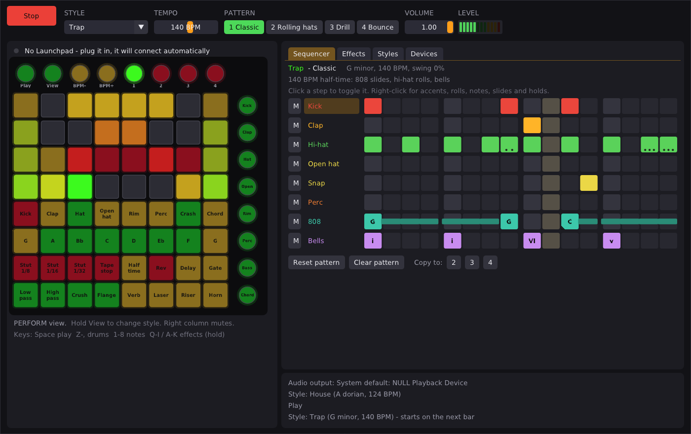

# lp-dnb

A multi-style groovebox for the original Novation **Launchpad Mini** (micro-USB, mk1/mk2), written in C++17.
It started as drum & bass and now has **12 styles and 48 patterns**. Each style has its own drum kit,
bass synth, chord sound, key, swing and effects, and the Launchpad remaps itself for each one.
Everything is synthesised live (no samples), and every effect has its own light pattern on the pads.



On Windows it opens a window with an on-screen Launchpad that mirrors the real one's lights (and can
be clicked), a step sequencer, the effects, a style browser and a devices panel. Devices are detected
live: plug the Launchpad in (or pull it out and plug it back) at any time and it reconnects by itself.
Other MIDI keyboards and pad controllers are picked up automatically too.

## Styles

| Style | BPM | Key | Sounds | Patterns |
|---|---|---|---|---|
| Drum & Bass | 174 | F minor | Punchy kick, ghost snares, Reese bass, rave stabs | Two-step, Amen roller, Jungle, Liquid |
| House | 124 | A dorian | 909 kick, clap, shaker, deep sub, organ stabs | Classic, Deep, Jackin', Piano house |
| Techno | 132 | E phrygian | Rumbling kick, acid 303 with slides and accents, dub chords | Peak time, Hypnotic, Industrial, Acid |
| Hip-hop | 90 | D dorian | Dusty kick, swung hats, round bass, Rhodes | Boom bap, Off-kilter, Laid back, Jazzy |
| Trap | 140 | G minor | 808 with pitch drop and slides, hi-hat rolls, bells | Classic, Rolling hats, Drill, Bounce |
| Dubstep | 140 | F phrygian | Heavy kick, huge snare, tempo-synced wobble bass, dark pad | Half-time, Wobble, Riddim, Dub |
| UK Garage | 132 | G minor | Heavy shuffle, rims, organ bass, M1 organ stabs | 2-step, Speed garage, Bumpy, Vocal |
| Reggaeton | 95 | A minor | Dembow snare, timbales, sub bass, plucks | Dembow, Perreo, Dancehall, Moombah |
| Disco | 118 | E dorian | Tambourine, cowbell, slap bass, strings | Four on the floor, Funk, Nu-disco, Cowbell groove |
| Synthwave | 100 | A minor | Gated snare, 80s toms, pulsing arp bass, wide pads | Drive, Night drive, Outrun, Ballad |
| Lo-fi | 78 | D dorian | Soft kit, lazy swing, warm sub, jazzy electric piano | Chill, Study, Rainy, Jazz hop |
| Afro House | 122 | G dorian | Congas, shaker, clave, cowbell, marimba | Afro house, Afrobeats, Tribal, Log drum |

Chords are built from each style's scale, so they always fit the key (minor 7ths, major 9ths and so on
come out naturally). Switching style or pattern happens at the end of the bar, and switching style also
sets that style's tempo.

## Build

You need CMake (3.16+) and a C++17 compiler. The libraries it uses (RtMidi for MIDI, miniaudio for
audio, Dear ImGui for the window) are included in `third_party/`, so there is nothing else to download.

**Windows (Visual Studio 2019/2022, "Desktop development with C++")**

```
cmake -S . -B build
cmake --build build --config Release
build\Release\lp-dnb.exe
```

Using the CMake GUI instead: set "Where to build the binaries" to a `build` folder **inside** the
project (e.g. `.../lp-dnb/build`), not the project folder itself. Press Configure, then Generate,
then Open Project and build the `Release` configuration in Visual Studio.

**macOS / Linux** build a console version (same synth, lights and hot-plugging, no window).

**macOS**

```
cmake -S . -B build && cmake --build build -j
./build/lp-dnb
```

**Linux** (install ALSA headers first: `sudo apt install libasound2-dev`)

```
cmake -S . -B build && cmake --build build -j
./build/lp-dnb
```

Close any other app that's using the Launchpad (Ableton, Novation Components). On Windows only one
program can open a MIDI port at a time; LP-DNB keeps trying and connects as soon as it's free.

Console options: `--list` (show MIDI ports), `--style N` (start in style N), `--audio "device name"`,
`--demo out.wav` (render two patterns from every style), `--test [out.wav]` (render all 48 patterns
and print their levels; no hardware needed for either).

## Launchpad layout

```
 (Play) (View) (BPM-) (BPM+) (Pat1) (Pat2) (Pat3) (Pat4)        <- round top buttons

 [ ][ ][ ][ ][ ][ ][ ][ ]   rows 1-4: light show                (track 1)
 [ ][ ][ ][ ][ ][ ][ ][ ]     EDIT view: rows 1-2 = 16 steps     (track 2)
 [ ][ ][ ][ ][ ][ ][ ][ ]     hold View: style picker            (track 3)
 [ ][ ][ ][ ][ ][ ][ ][ ]                                        (track 4)
 6 drum sounds + 1 extra + Chord       the style's kit           (track 5)
 8 notes in the style's key            bass                      (track 6)
 8 effects                             hold, per style           (Bass)
 8 effects                             hold, per style           (Chords)
                                                   right column -^
```

- **Play** starts/stops. **View**: tap to flip between PERFORM and EDIT; **hold** it and tap a pad in
  the top half to pick a style (the pads light in each style's colour; the current one blinks).
- **Pat 1–4**: the four patterns of the current style. Switches land on the next bar.
- **Drum row**: the style's six drum tracks, an extra one-shot (crash, cowbell, clap...), and on the
  right the style's chord sound, played on the last note pad you pressed. Hold it to sustain pads.
- **Note row**: one octave of the style's scale on its bass synth.
- **Right column**: PERFORM = mute/unmute each track; EDIT = pick the track to edit.
- **EDIT view**: top two rows are the 16 steps. Tap to toggle. For bass and chords, hold a step and
  press a note pad to set its note.
- **Hold View + Pat N**: copy the current pattern into slot N. **Hold View + right column** (EDIT): clear that track.

## The window (Windows)

- **Top bar**: Play/Stop, style, tempo, the style's patterns (switch on the next bar), volume, level meter.
- **Launchpad** (left): a live copy of the lights, labelled for the current style. Click and hold pads
  exactly like the hardware.
- **Sequencer** tab: click a step to toggle it. Right-click for more: accents, ghost notes, 2- and
  3-hit rolls on drums; notes, accents, slides and holds on the bass; chords (shown as i, IV, VII7...)
  and holds on the chord track. M mutes a track; clicking a track name selects it for the Launchpad's
  EDIT view. Reset / clear / copy patterns.
- **Effects** tab: the style's 16 effects. Hold a button to play one; hover for a description.
- **Styles** tab: all 12 styles with tempo, key and a description. Click to switch.
- **Devices** tab: Launchpad status and port choice (auto-detect by default), other MIDI inputs with an
  on/off tick each and an activity light, and the audio output. Everything is rescanned every second.
  If your chosen audio device is unplugged, sound moves to the system default and switches back
  when it returns.
- **Computer keyboard**: Space = play/stop, Z X C V B N M , = drum row, 1–8 = notes,
  Q–I and A–K = hold effects (same order as the pads).

## Other MIDI controllers

Any MIDI input that isn't the Launchpad is connected automatically when plugged in. Notes play the
current style's bass (in its key, folded into range); notes on channel 10 (General MIDI drums, as most
pad controllers send) play the style's kit: 36 kick, 38 second drum, 42 third, 46 fourth, 39/51 fifth,
toms sixth, 49 crash/extra.

## Effects and their lights

Each style puts 16 of these on its two effect rows.

| Effect | Sound | Lights |
|---|---|---|
| Stutter 1/4 … 1/32 | Loops the last slice of audio | Flash + sweep / alternating halves / checkerboard / glitch strobe, all synced to the repeat |
| Tape stop | Audio winds down to a halt | Red stripes that slow down and fade with the tape |
| Half-time | Sequencer runs at half speed | Slow orange breathing glow |
| Reverse | Last beat played backwards | Green scanner running right to left |
| Delay throw | Dotted-⅛ ping-pong echoes | Rings bouncing left/right, fading with each echo |
| Low-pass / High-pass | Resonant filter sweep on the master | A red ceiling closing down / amber floor rising up |
| Bitcrush | Sample-rate + bit reduction | Chunky random 2×2 blocks every 16th |
| Flanger | Jet sweep | Diagonal red/green waves |
| Reverb wash | Big send + longer tail | Sparkles that bloom and diffuse, and fade with the tail |
| Dub siren | Classic swooping siren into the delay | Rotating police-light beams |
| Noise riser | Builds while held (up to ~6 s) | Fills from the bottom, strobing faster; full flash on release (the drop) |
| Air horn | Brassy horn | Concentric squares exploding outward |
| Sidechain pump | Ducks the whole mix on every beat | The grid sucks in on each beat and swells back |
| Trance gate | Chops the mix into 16ths | Columns blink on and off with the gate |
| Lo-fi vinyl | Dark, warbly, crackly | Warm flicker with dust specks |
| Laser zap | Pew-pew every 8th note into the delay | Beams shooting across random rows |

Even with no effects held, the top half is a live level meter per track. Kicks send red ripples up from
the bottom, snares and claps drop amber ones from the top, chords close in from the sides, toms and
congas roll in from the corners, and every pad you touch sends a ripple. Switching style sweeps the
style's colour across the grid. When stopped, it idles with a slow plasma.

## Adding your own

Styles and patterns live in `src/styles.cpp` as plain text, one row per track:

```
pat("Two-step", {"x.........x.....",   // drums: x hit  X accent  o ghost  r 2-hit roll  t 3-hit roll
                 "....x.......x...",
                 ...
                 "0--0--2---0--3--",   // bass: 0-9 scale degree, - hold, A-J accent, a-j slide
                 "0-----5-------3-"}), // chords: degree of the chord's root, - hold
```

## Code map

- `src/styles.cpp` – every style: sounds, key, swing, effect layout and patterns
- `src/engine.cpp` – drum/bass/chord voices, sequencer (swing, rolls, slides), master FX chain (audio thread)
- `src/controller.cpp` – button mapping (remapped per style) and all the light patterns (main thread)
- `src/launchpad.cpp` – MIDI hub: hot-plug scanning, Launchpad protocol (double-buffered LED updates), other inputs
- `src/app.cpp` – glues it together; audio device selection and hot-plug
- `src/gui.cpp`, `src/main_win32.cpp` – the Windows window (Dear ImGui + Direct3D 11)
- `src/main_console.cpp` – console front-end for macOS / Linux, plus the offline demo/test renderer
