<p align="center">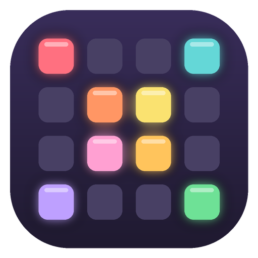</p>

<h1 align="center">LP-DNB</h1>

<p align="center"><b>A groovebox for the original Novation Launchpad Mini</b> (the micro-USB mk1 / mk2)<br>
12 styles &middot; 96 built-in patterns &middot; synth or sampled drums &middot; light shows on every pad</p>

<p align="center"><a href="LICENSE"></a></p>

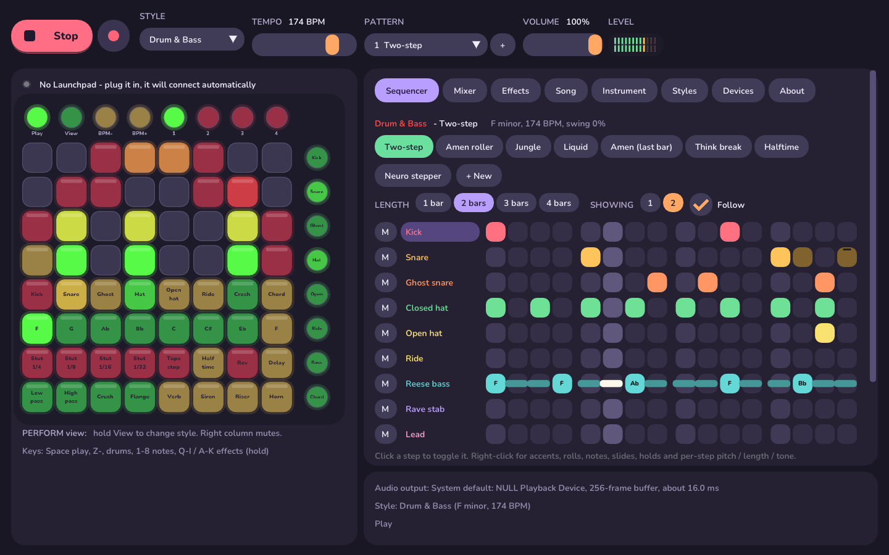

LP-DNB turns the old Launchpad Mini into a self-contained beat machine. Pick a style (drum & bass, house,
techno, hip-hop, trap, dubstep, UK garage, reggaeton, disco, synthwave, lo-fi or afro house) and the
Launchpad remaps itself: a drum kit, a bass in the style's key, chord stabs, and sixteen performance effects
(stutters, tape stop, filter sweeps, sirens, risers...), each with its own animated light pattern.

**What it does**

- **Plays and lights up**: drums, bass, chords and effects on the pads, with ripples, meters and per-effect
  light shows. Unplug and replug the Launchpad any time; it reconnects by itself.
- **12 styles, 96 patterns**: each style has its own sounds, key, swing and effect layout. Every built-in
  pattern is two bars with fills and variations.
- **Sequencer**: up to 4-bar patterns, accents, ghost notes, rolls, slides, holds and per-step pitch /
  length / tone. Make and name your own patterns; everything is saved automatically.
- **Sound**: a stereo synth engine (ladder-filter basses, supersaw chords, real sidechain, reverb, delay,
  chorus, glue compressor and limiter). Swap any drum for your own WAV samples.
- **Mixer** with levels, pan, sends and tone for every sound; **song mode** to chain patterns.
- **Second keyboard**: plug in any MIDI keyboard to play a lead synth (17 sounds) over the beat, and record
  it into the pattern.
- **Record and export**: record to WAV, export patterns as MIDI files, sync with other gear by MIDI clock.
- **Windows app** with an on-screen Launchpad you can click, plus a console version for macOS and Linux.
- **lp-tenori**, a second program: a Tenori-on style sequencer with 8 layers, each with its own instrument,
  playing in Score, Bounce, Path or Push mode ([more below](#lp-tenori-a-tenori-on-on-the-launchpad)).

| | |
|---|---|
| 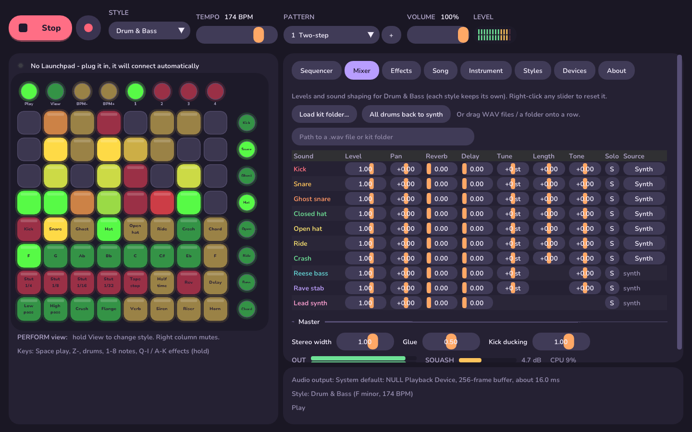 **Mixer**: every sound, sampled drums, master | 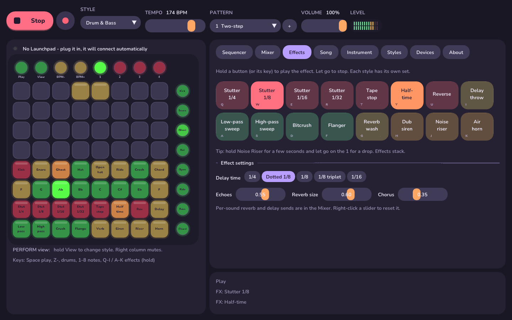 **Effects**: hold to play, with their settings |
| 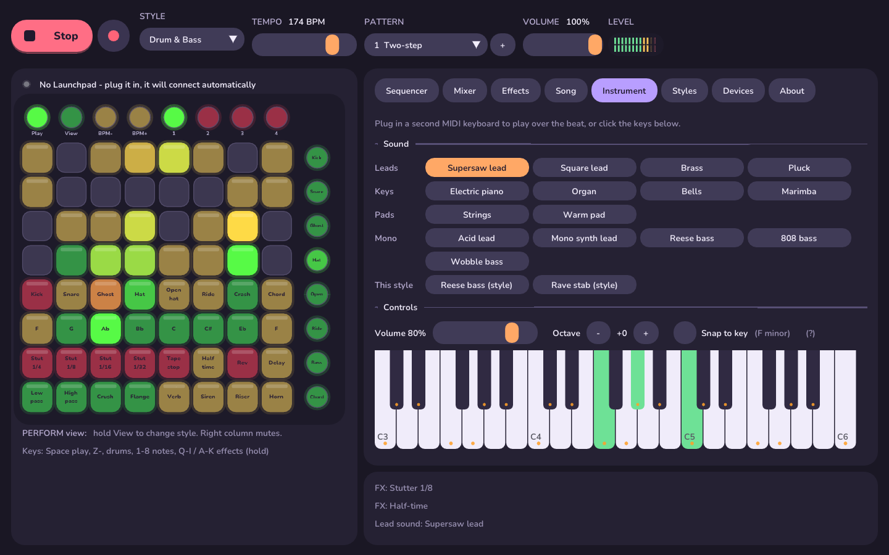 **Instrument**: the lead synth for a second keyboard | 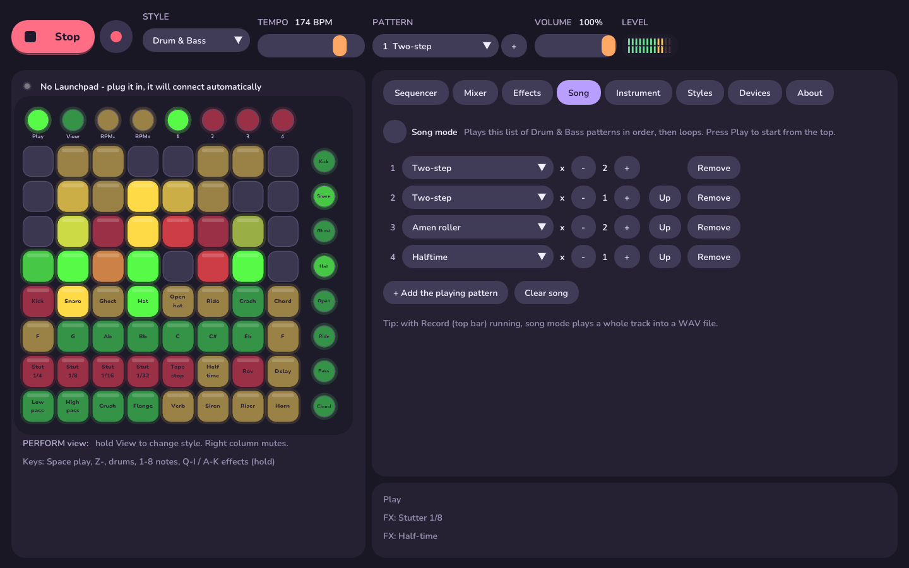 **Song**: chain patterns |
| 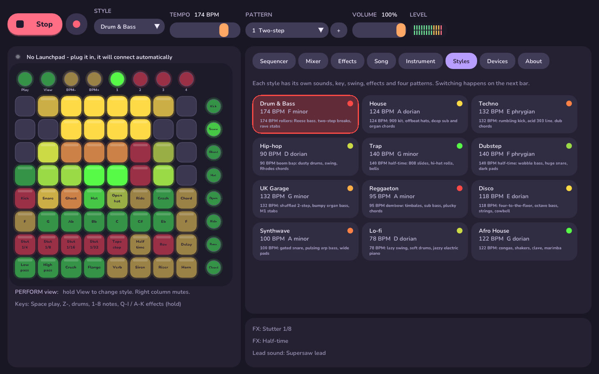 **Styles**: twelve genres | 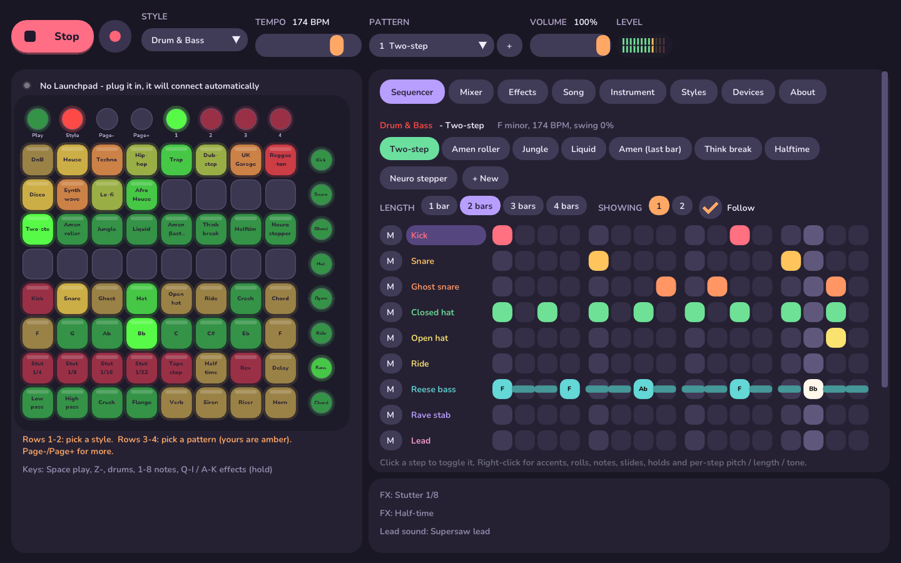 **Hold View**: pick styles and patterns on the Launchpad |
| 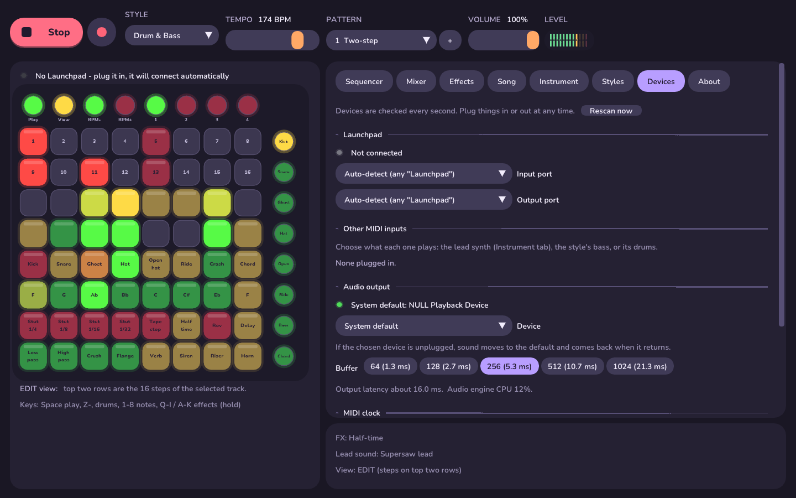 **Devices**: Launchpad, keyboards, audio, MIDI clock | 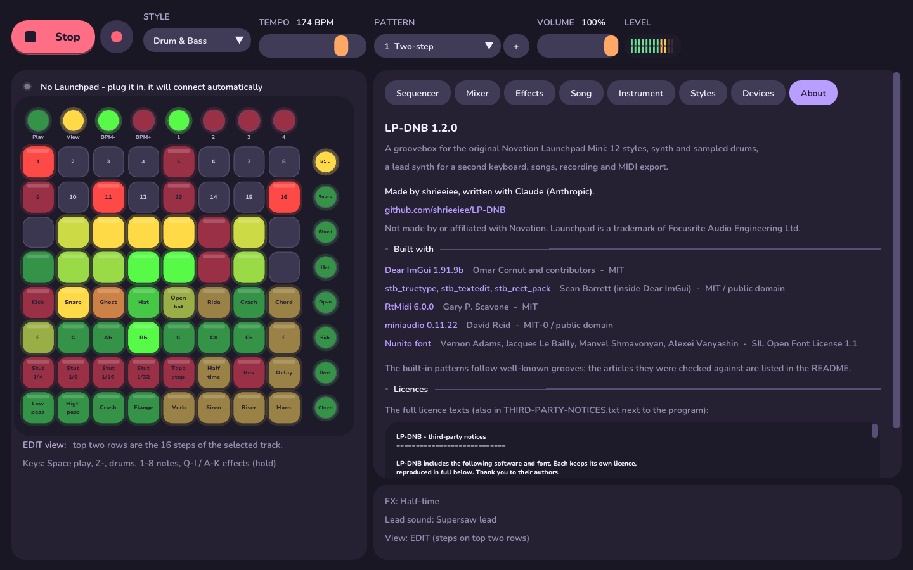 **About**: credits and licences |

## Getting it

**Windows**: download `LP-DNB-windows.zip` from the [latest release](https://github.com/shrieeiee/LP-DNB/releases/latest),
unzip it anywhere and double-click `lp-dnb.exe` (or `lp-tenori.exe`). Nothing to install. The programs aren't
signed, so the first time Windows may say "Windows protected your PC": click **More info**, then **Run anyway**.

Releases are built by GitHub Actions ([`.github/workflows/release.yml`](.github/workflows/release.yml)) whenever a
version tag is pushed (`git tag v1.3.1 && git push origin v1.3.1`), using `packaging/release-notes.md` as the
release text.

Or build it yourself with the steps under [Build](#build) (Visual Studio 2019/2022 and CMake). Keep
`THIRD-PARTY-NOTICES.txt` with the programs if you pass them on.

If a window ever stops responding, wait ten seconds and look in `%APPDATA%\LP-DNB` for
`lp-dnb-freeze-log.txt` or `lp-tenori-freeze-log.txt`: it records what the program was doing (including where
in the code), which makes it quick to fix. Please attach it to an issue.

**macOS / Linux**: the same steps build the console version.

Then plug in the Launchpad Mini (close Ableton or Novation Components first) and press Play.

There's also a second program, **lp-tenori**: a Tenori-on style sequencer that plays the same sound engine
from the Launchpad (see [below](#lp-tenori-a-tenori-on-on-the-launchpad)).

## The sound engine

- **Stereo throughout**, with hats, percussion and toms placed across the field, wide unison chords and
  a stereo chorus.
- **Drums**: kicks with a beater click layer, snares with a rattling wire layer, wide claps, band-limited
  (alias-free) hats and cowbells. Each drum can have its own **tune, length and tone**, and any drum can be a
  **WAV sample** instead (single files, or a whole kit folder matched by file name).
- **Bass**: a 24 dB **ladder filter** (303 / Moog style) on the acid, Reese and wobble basses, an
  anti-aliased drive stage, filter updated every sample for smooth sweeps.
- **Chords and leads**: up to **7-voice supersaw** unison per note, spread across the stereo field.
- **Sidechain**: the kick really ducks the bass and chords (an envelope follower on the kick, with a
  release set per style), and you can set how much.
- **Effects**: a smooth 8-line reverb with adjustable size, a tempo-synced ping-pong delay (1/4, dotted 1/8,
  1/8, 1/8 triplet, 1/16) with adjustable echoes, chorus, plus per-sound reverb and delay sends.
- **Master**: gentle EQ, "glue" bus compression, stereo width, and a look-ahead limiter so it never clips.
- **Feel**: humanise (tiny timing and loudness variations), hat-only swing, automatic drum fills every 4, 8
  or 16 bars.
- **Per-step locks**: any step can have its own pitch, length and tone / filter (right-click a step).
- **Timing**: pads, keys and MIDI land with sample accuracy (constant latency, no block jitter); the audio
  buffer size is adjustable, and Windows can use WASAPI exclusive mode for the lowest latency.

On Windows it opens a window with an on-screen Launchpad that mirrors the real one's lights (and can
be clicked), a step sequencer, the effects, the lead instrument, a style browser and a devices panel. Devices are detected
live: plug the Launchpad in (or pull it out and plug it back) at any time and it reconnects by itself.
Other MIDI keyboards and pad controllers are picked up automatically too.

## Styles

| Style | BPM | Key | Sounds | Patterns |
|---|---|---|---|---|
| Drum & Bass | 174 | F minor | Punchy kick, ghost snares, Reese bass, rave stabs | Two-step, Amen roller, Jungle, Liquid, Amen (last bar), Think break, Halftime, Neuro stepper |
| House | 124 | A dorian | 909 kick, clap, shaker, deep sub, organ stabs | Classic, Deep, Jackin', Piano house, Chicago jack, Shuffle, Tech house, Garage house |
| Techno | 132 | E phrygian | Rumbling kick, acid 303 with slides and accents, dub chords | Peak time, Hypnotic, Industrial, Acid, Hard techno, Detroit, Minimal roller, Electro |
| Hip-hop | 90 | D dorian | Dusty kick, swung hats, round bass, Rhodes | Boom bap, Off-kilter, Laid back, Jazzy, Funky Drummer, Impeach, Head nod, Bongo break |
| Trap | 140 | G minor | 808 with pitch drop and slides, hi-hat rolls, bells | Classic, Rolling hats, Drill, Bounce, Triplet flow, Atlanta bounce, Grime hats drill, Rage |
| Dubstep | 140 | F phrygian | Heavy kick, huge snare, tempo-synced wobble bass, dark pad | Half-time, Wobble, Riddim, Dub, Deep dub, Brostep, Tearout, Ghost hats |
| UK Garage | 132 | G minor | Heavy shuffle, rims, organ bass, M1 organ stabs | 2-step, Speed garage, Bumpy, Vocal, Classic 2-step, Future garage, 4x4 garage, Grime |
| Reggaeton | 95 | A minor | Dembow snare, timbales, sub bass, plucks | Dembow, Perreo, Dancehall, Moombah, Dembow timbal, Trapeton, One drop, Cumbia |
| Disco | 118 | E dorian | Tambourine, cowbell, slap bass, strings | Four on the floor, Funk, Nu-disco, Cowbell groove, Philly, Boogie, Italo, Salsoul |
| Synthwave | 100 | A minor | Gated snare, 80s toms, pulsing arp bass, wide pads | Drive, Night drive, Outrun, Ballad, Darksynth, Retro halftime, Power ballad, Chillwave |
| Lo-fi | 78 | D dorian | Soft kit, lazy swing, warm sub, jazzy electric piano | Chill, Study, Rainy, Jazz hop, Dilla swing, Bossa, Brushes, Dusty boom bap |
| Afro House | 122 | G dorian | Congas, shaker, clave, cowbell, marimba | Afro house, Afrobeats, Tribal, Log drum, Amapiano, Afrobeat, Gqom, Afro tech |

Every built-in pattern is two bars long: the second bar adds the little end-of-phrase moves (ghost-note
pickups, an open hat into the next bar, the bass jumping an octave), and hat lines get strong/weak dynamics.

Chords are built from each style's scale, so they always fit the key (minor 7ths, major 9ths and so on
come out naturally). Switching style or pattern happens at the end of the bar, and switching style also
sets that style's tempo.

## Your own patterns

Every style holds up to 24 patterns: its 8 built-in ones plus 16 of your own.

- **New pattern**: the **+** next to the pattern list, or **+ New** in the Sequencer tab. Give it a name
  and start from a copy of the current pattern or from scratch. **Duplicate** makes a copy of whatever's playing.
- **Rename / Delete** work on your own patterns. Built-in ones can be edited too, and **Reset** puts them back.
- **On the Launchpad**: hold **View** and the top half shows styles (rows 1-2) and this style's patterns
  (rows 3-4; yours are amber; BPM-/BPM+ page through if there are more than 16). The **Pat 1-4** buttons step
  through the page of four the current pattern is on.
- **Saving is automatic.** Patterns, edits and settings (style, tempo, volume, audio device, lead sound,
  what each keyboard plays) are written to a readable text file whenever they change:
  - Windows: `%APPDATA%\LP-DNB\lp-dnb-data.txt`
  - macOS: `~/Library/Application Support/LP-DNB/lp-dnb-data.txt`
  - Linux: `~/.config/lp-dnb/lp-dnb-data.txt`

  Patterns in it use the same text format as `src/styles.cpp`, so you can copy them between the two.

## Longer patterns and songs

- **Length**: 1 to 4 bars (Sequencer tab). Making a pattern longer repeats what's there, ready to vary.
  **Showing** picks which bar you're editing (or **Follow** the playhead). On the Launchpad's EDIT view, BPM-/BPM+
  page through the bars of a long pattern.
- **Song** tab: a list of this style's patterns, each played 1-16 times, in order, then looping. Tick
  **Song mode** and press Play.

## Mixer and samples

The **Mixer** tab has a row for every sound in the style (each style keeps its own settings): level, pan,
reverb and delay sends, tune, length, tone and solo. Right-click any slider to reset it. Below it: stereo width,
glue compression, kick ducking, a stereo meter, how hard the limiter is working, and CPU use.

**Source** on each drum row switches it between the synth and a WAV file (8/16/24/32-bit or float, mono or
stereo, any sample rate). **Load kit folder...** picks a folder and matches its files to the style's drums by
name (kick/bd, snare/sd, clap, hat/hh, open/oh, ride, crash, rim, tom, conga, shaker, cowbell...). You can also
drag WAV files or a folder onto the window: onto a row in the Mixer to replace that sound.
Samples are remembered between sessions.

## Recording and exporting

- **Record** (the round button next to Play) writes what you hear to a 24-bit WAV.
- **Export MIDI** (Sequencer tab) saves the pattern as a .mid file with drums (General MIDI notes), bass,
  chords and lead on separate tracks, with the tempo and swing.
- **Rec lead** (Sequencer tab) records the lead keyboard into the pattern's Lead row, snapped to the nearest step.

Files go in `Music\LP-DNB` (Windows) or `~/Music/LP-DNB`.

## MIDI clock

In **Devices**: **Send clock to** another MIDI device (24 ticks per beat plus Start/Stop, locked to the audio
engine), or **Follow clock from** one of your MIDI inputs: LP-DNB takes its tempo, Start and Stop.

## Playing over the top (second MIDI instrument)

Plug in any other MIDI keyboard and it plays the **lead synth** over the beat. In the **Instrument** tab:

- **Sound**: Supersaw lead, Square lead, Brass, Pluck, Electric piano, Organ, Bells, Marimba, Strings,
  Warm pad (all polyphonic); Acid lead, Mono synth lead, Reese bass, 808 bass, Wobble bass (mono, gliding
  between held notes); or the current style's own bass or chord sound.
- **Volume**, **Octave** (-3 to +3) and **Snap to key**, which moves any wrong note to the nearest note in the
  style's key. Orange dots on the keyboard show which notes are in the key.
- Velocity, sustain pedal, pitch bend (+/-2 semitones) and mod wheel (vibrato) all work.
- The on-screen keyboard can be clicked and dragged to try sounds without a MIDI keyboard.
- Each keyboard can instead play the style's **bass** or its **drums**: choose next to its name (Instrument
  or Devices tab). Notes on channel 10 always play drums.
- The lead goes through the same effects as everything else, and each note sends a ripple across the
  Launchpad, placed by pitch.

## Where the patterns come from

The built-in patterns are written for this app's step grid. The second set of four per style follows well-known
grooves and common genre templates: classic breaks (Amen, Think, Funky Drummer, Impeach the President), the dembow
3-3-2 spacing, Chicago/tech/garage house, 2-step and 4x4 garage, grime/drill hi-hat cadences, amapiano log-drum
placement, and so on. Breakdowns used as references:
[FaderPro: 5 kick and snare patterns](https://blog.faderpro.com/techniques/5-kick-and-snare-patterns-you-need-to-know/),
[Ethan Hein: Building the Amen break](https://ethanhein.substack.com/p/building-the-amen-break),
[Amped Studio: how to make a house beat](https://ampedstudio.com/blog/how-tomake-a-house-beat/),
[Attack Magazine: UK drill, Beat Dissected](https://www.attackmagazine.com/technique/beat-dissected/uk-drill/),
[UJAM: how to make a dembow groove](https://www.ujam.com/tutorials/how-to-make-a-dembow-groove/),
[RouteNote: how to make an amapiano beat](https://create.routenote.com/blog/beatmakers-guide-how-to-make-an-amapiano-beat/).

## Build

You need CMake (3.16+) and a C++17 compiler. The libraries it uses (RtMidi for MIDI, miniaudio for
audio, Dear ImGui for the window) are included in `third_party/`, so there is nothing else to download.

**Windows (Visual Studio 2019/2022, "Desktop development with C++")**

```
cmake -S . -B build
cmake --build build --config Release
build\Release\lp-dnb.exe
```

Using the CMake GUI instead: set "Where to build the binaries" to a `build` folder **inside** the
project (e.g. `.../lp-dnb/build`), not the project folder itself. Press Configure, then Generate,
then Open Project and build the `Release` configuration in Visual Studio.

**macOS / Linux** build a console version (same synth, lights and hot-plugging, no window).

Every platform also builds `lp-tenori` (the Tenori-on style sequencer) next to `lp-dnb`: a window on Windows
(`build\Release\lp-tenori.exe`), a console program on macOS and Linux.

**macOS**

```
cmake -S . -B build && cmake --build build -j
./build/lp-dnb
```

**Linux** (install ALSA headers first: `sudo apt install libasound2-dev`)

```
cmake -S . -B build && cmake --build build -j
./build/lp-dnb
```

Close any other app that's using the Launchpad (Ableton, Novation Components). On Windows only one
program can open a MIDI port at a time; LP-DNB keeps trying and connects as soon as it's free.

Console options: `--list` (show MIDI ports), `--style N` (start in style N), `--audio "device name"`,
`--demo out.wav` (render two patterns from every style), `--test [out.wav]` (render all 96 built-in patterns
and print their levels, limiter activity and CPU use; no hardware needed for either).

`lp-dnb-tests` (built alongside) checks the engine offline: WAV loading in every format, kit-folder matching,
sample-accurate timing (including notes scheduled ahead), sampled drums, the limiter ceiling, stereo output, long
patterns and song mode, that the save file round-trips exactly, and lp-tenori's Bounce / Score / Path timing,
mutes and save file.

## Launchpad layout

```
 (Play) (View) (BPM-) (BPM+) (Pat1) (Pat2) (Pat3) (Pat4)        <- round top buttons

 [ ][ ][ ][ ][ ][ ][ ][ ]   rows 1-4: light show                (track 1)
 [ ][ ][ ][ ][ ][ ][ ][ ]     EDIT view: rows 1-2 = 16 steps     (track 2)
 [ ][ ][ ][ ][ ][ ][ ][ ]     hold View: style picker            (track 3)
 [ ][ ][ ][ ][ ][ ][ ][ ]                                        (track 4)
 6 drum sounds + 1 extra + Chord       the style's kit           (track 5)
 8 notes in the style's key            bass                      (track 6)
 8 effects                             hold, per style           (Bass)
 8 effects                             hold, per style           (Chords)
                                                   right column -^
```

- **Play** starts/stops. **View**: tap to flip between PERFORM and EDIT; **hold** it to show the picker:
  styles on rows 1-2 (lit in each style's colour; the current one blinks) and this style's patterns on
  rows 3-4 (built-in green, yours amber).
- **Pat 1–4**: patterns of the current style, four at a time (the page the current pattern is on).
  Switches land on the next bar.
- **Drum row**: the style's six drum tracks, an extra one-shot (crash, cowbell, clap...), and on the
  right the style's chord sound, played on the last note pad you pressed. Hold it to sustain pads.
- **Note row**: one octave of the style's scale on its bass synth.
- **Right column**: PERFORM = mute/unmute each track; EDIT = pick the track to edit.
- **EDIT view**: top two rows are the 16 steps of one bar (BPM-/BPM+ change bar on longer patterns). Tap to toggle. For bass and chords, hold a step and
  press a note pad to set its note.
- **Hold View + Pat N**: copy the current pattern into slot N. **Hold View + right column** (EDIT): clear that track.

## The window (Windows)

- **Top bar**: Play/Stop, Record, style, pattern list (with **+** for a new one), tempo, volume, stereo level meter.
- **Launchpad** (left): a live copy of the lights, labelled for the current style. Click and hold pads
  exactly like the hardware.
- **Sequencer** tab: click a step to toggle it. Right-click for more: accents, ghost notes, 2- and
  3-hit rolls on drums; notes, accents, slides and holds on the bass; chords (shown as i, IV, VII7...)
  and holds on the chord track. M mutes a track; clicking a track name selects it for the Launchpad's
  EDIT view. Above the grid, every pattern of the style and the length / bar selector; below it, Duplicate,
  Rename, Delete, Reset, Clear, Rec lead, Export MIDI, and the Feel settings (humanise, hat swing, fills).
  A small notch on a step means it has its own pitch / length / tone.
- **Mixer** tab: levels, sends and sound controls for every sound, sampled drums, master settings.
- **Effects** tab: the style's 16 effects. Hold a button to play one; hover for a description. Below:
  delay time and echoes, reverb size, chorus.
- **Song** tab: chain patterns into a song.
- **About** tab: version, credits and the licences of everything LP-DNB is built on.
- **Instrument** tab: the lead synth for a second MIDI keyboard (see above), with a playable keyboard.
- **Styles** tab: all 12 styles with tempo, key and a description. Click to switch.
- **Devices** tab: Launchpad status and port choice (auto-detect by default), other MIDI inputs with an
  on/off tick each and an activity light, and the audio output. Everything is rescanned every second.
  If your chosen audio device is unplugged, sound moves to the system default and switches back
  when it returns. Also: audio buffer size and exclusive mode, MIDI clock in/out, and the recordings folder.
- **Computer keyboard**: Space = play/stop, Z X C V B N M , = drum row, 1–8 = notes,
  Q–I and A–K = hold effects (same order as the pads).

## lp-tenori: a Tenori-on on the Launchpad

`lp-tenori` is a separate program built alongside `lp-dnb`. It turns the Launchpad into a Tenori-on: light-up
grid sequencing with **8 layers** playing at once, each with its own **instrument**, way of playing, octave, loop
length and volume. It uses LP-DNB's sound engine, so every style's drum kit, bass, chords, effects, mixer settings
and sampled drums are there, and every layer can also have **its own synth** (17 sounds: leads, keys, pads, mono
synths and the style's chord sound). Every note sends a ripple of light out across the grid in its layer's colour.

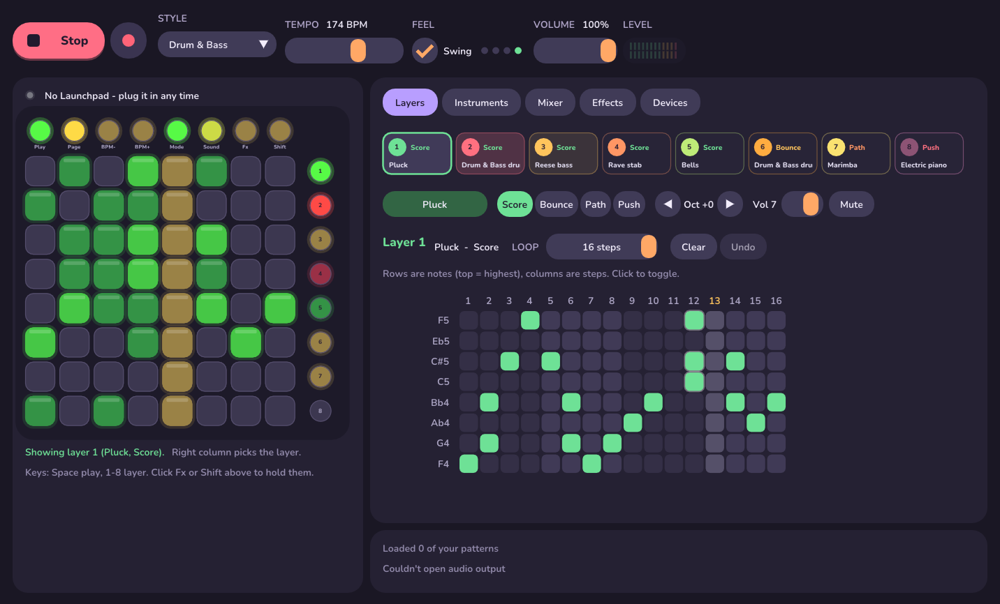

| | | |
|---|---|---|
| 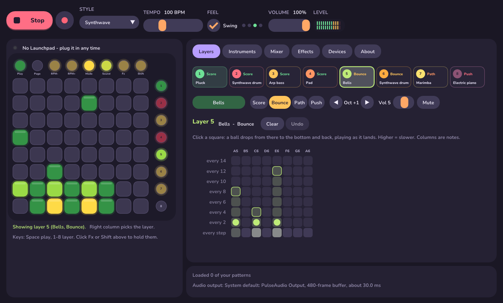 **Bounce**: balls in flight; higher repeats slower | 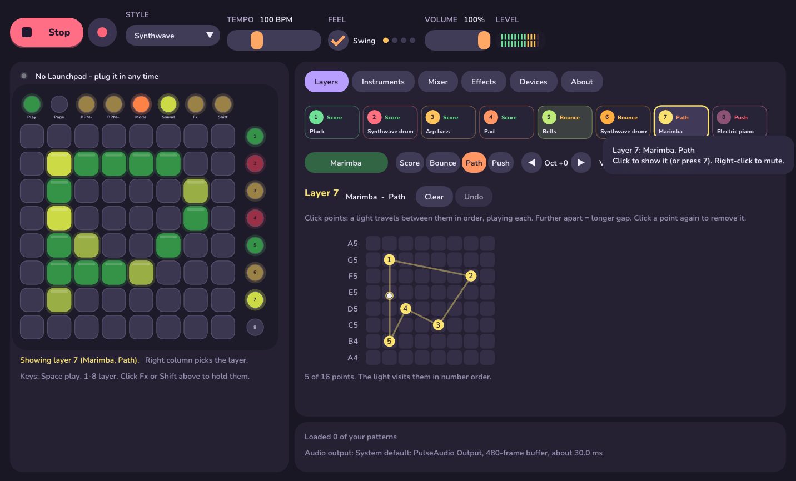 **Path**: the light travels the route you draw | 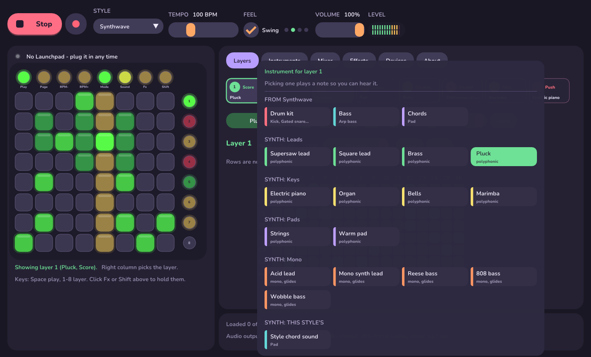 **Instrument picker**: every layer its own sound |

### The window (Windows)

- **Top bar**: Play/Stop, Record (to WAV), style, tempo, swing, volume and level.
- **Launchpad** (left): a live copy of the lights that you can click like the real one. Click **Fx** or **Shift**
  to hold them (click again to let go), so the settings page works with a mouse too.
- **Layers**: the eight layers as cards (they flash as they play; click one to show it, right-click to mute it), then
  the selected layer's **instrument**, **mode**, octave, volume and mute, then a big editor for it:
  - **Score**: all 16 steps at once, with note names down the side (click a name to hear it). Click or drag to
    paint notes; the loop length marker shows where the layer wraps round.
  - **Bounce**: click where to drop a ball in each column; the balls bounce live, and each row says how often it lands.
  - **Path**: numbered points joined by the route, with the light travelling along it.
  - **Push**: hold a square with the mouse to repeat it; columns are labelled with their speeds.
- **Instruments**: the instrument picker for each layer as big buttons, grouped (this style's drums / bass / chords,
  then Leads, Keys, Pads, Mono and the style's chord sound). Picking one plays a note so you hear it. Below: which sound
  other MIDI keyboards play. The same picker opens from the instrument button on the Layers page.
- **Mixer**, **Devices** and **About**: the same as in lp-dnb (the layer synths go through the Mixer's Lead channel).
- **Effects**: hold any of the style's 16 effects, plus delay, reverb and chorus settings.
- **Keys**: Space = play/stop, 1-8 = show that layer.

On macOS and Linux lp-tenori is a console program (Launchpad, sound and saving all the same) that prints what's
selected on one status line. Options: `--list`, `--style N`, `--audio "device name"`, and
`--demo [out.wav] [--style N] [--bars N]`, which renders a little scene using every mode offline (no hardware
needed) and prints how many notes each sound played.

### On the Launchpad

```
 (Play) (Page) (BPM-) (BPM+) (Mode) (Sound) (Fx) (Shift)     <- round top buttons

 [ ][ ][ ][ ][ ][ ][ ][ ]  (layer 1)
 [ ][ ][ ][ ][ ][ ][ ][ ]  (layer 2)        the grid: the selected layer
 ...                        ...             right column: pick a layer
 [ ][ ][ ][ ][ ][ ][ ][ ]  (layer 8)
```

**Modes** (each layer has one; **Mode** steps through them):

| Mode | How it plays |
|---|---|
| Score | Rows are notes (top = highest), columns are steps. Tap to toggle. Loops are 1-16 steps; **Page** flips between steps 1-8 and 9-16 (and by default the page follows the playhead). Each layer can have its own length, so layers drift against each other. |
| Bounce | Tap a pad and a ball drops from it to the bottom row and back up, playing as it lands. The higher you tap, the slower it repeats, so balls at different heights make polyrhythms. Columns are notes. Tap the same pad to remove a ball. |
| Path | Tap points and a light travels between them in the order you placed them, playing each one. The further apart two points are, the longer the gap, so the shape you draw is the rhythm. Tap a point again to remove it. |
| Push | Hold pads to play them on repeat while held. Rows are notes, columns are how fast: from once a bar on the left to 1/64 notes on the right. |

**Instruments** (**Sound** steps through the kinds): **Drums** (rows are the style's kit, kick at the bottom, with
its chord stab on the top row; in Bounce mode the columns are the kit), **Bass**, **Chords** (a chord on each scale
degree) and **Synth** (the layer's own synth; pick its sound on the Shift page or in the window). Notes are always
in the style's key.

**Other buttons**

- **Right column**: pick the layer to show and edit. Layers with something in them glow, and flash as they play.
- **Fx** (hold): the bottom two rows become the style's 16 effects, as in lp-dnb. Hold an effect pad.
- **Shift** (hold) shows the settings page:
  - rows 1-2: **style** (sounds, key and tempo)
  - row 3: this layer's **instrument kind** (first four pads) and **mode** (last four)
  - row 4: **octave** -2 to +2, then three switches: show the other layers' notes faintly, swing, page follows playhead
  - rows 5-6: this layer's **synth sound** (green = polyphonic, red = mono, amber = the style's chord sound)
  - row 7: layer **volume**; row 8: Score **loop length** (tap a pad again for the odd length in between)
  - Shift + right column: **mute** a layer (red = muted)
  - Shift + **Mode**: clear this layer. Shift + **Play**: clear every layer. Shift + **Sound**: undo the clear (again to redo).
  - Shift + **BPM-/BPM+**: tempo in steps of 5
- When stopped, placing a note plays it so you can hear what you're adding.

Your layers, instruments, style and tempo are saved automatically to `lp-tenori.txt` next to LP-DNB's own save
file, and lp-tenori leaves LP-DNB's patterns and settings alone. Other MIDI keyboards still play a synth over the
top, and **Follow clock from** (set in lp-dnb) starts and stops it.

Things to know: the style's Bass is one monophonic synth, so two Bass layers share it (Synth layers don't share:
each has its own). MIDI clock *output* only follows lp-dnb's own sequencer, so it doesn't run in lp-tenori.

## Other MIDI controllers

Any MIDI input that isn't the Launchpad is connected automatically when plugged in. Notes play the
current style's bass (in its key, folded into range); notes on channel 10 (General MIDI drums, as most
pad controllers send) play the style's kit: 36 kick, 38 second drum, 42 third, 46 fourth, 39/51 fifth,
toms sixth, 49 crash/extra.

## Effects and their lights

Each style puts 16 of these on its two effect rows.

| Effect | Sound | Lights |
|---|---|---|
| Stutter 1/4 … 1/32 | Loops the last slice of audio | Flash + sweep / alternating halves / checkerboard / glitch strobe, all synced to the repeat |
| Tape stop | Audio winds down to a halt | Red stripes that slow down and fade with the tape |
| Half-time | Sequencer runs at half speed | Slow orange breathing glow |
| Reverse | Last beat played backwards | Green scanner running right to left |
| Delay throw | Tempo-synced ping-pong echoes (time set in the Effects tab) | Rings bouncing left/right, fading with each echo |
| Low-pass / High-pass | Resonant filter sweep on the master | A red ceiling closing down / amber floor rising up |
| Bitcrush | Sample-rate + bit reduction | Chunky random 2×2 blocks every 16th |
| Flanger | Jet sweep | Diagonal red/green waves |
| Reverb wash | Big send + longer tail | Sparkles that bloom and diffuse, and fade with the tail |
| Dub siren | Classic swooping siren into the delay | Rotating police-light beams |
| Noise riser | Builds while held (up to ~6 s) | Fills from the bottom, strobing faster; full flash on release (the drop) |
| Air horn | Brassy horn | Concentric squares exploding outward |
| Sidechain pump | Ducks the whole mix on every beat | The grid sucks in on each beat and swells back |
| Trance gate | Chops the mix into 16ths | Columns blink on and off with the gate |
| Lo-fi vinyl | Dark, warbly, crackly | Warm flicker with dust specks |
| Laser zap | Pew-pew every 8th note into the delay | Beams shooting across random rows |

Even with no effects held, the top half is a live level meter per track. Kicks send red ripples up from
the bottom, snares and claps drop amber ones from the top, chords close in from the sides, toms and
congas roll in from the corners, and every pad you touch sends a ripple. Switching style sweeps the
style's colour across the grid. When stopped, a slow wave in the style's colour drifts across, with the odd twinkle.

## Adding your own

Styles and patterns live in `src/styles.cpp` as plain text, one row per track:

```
pat("Two-step", {"x.........x.....",   // drums: x hit  X accent  o ghost  r 2-hit roll  t 3-hit roll
                 "....x.......x...",
                 ...
                 "0--0--2---0--3--",   // bass: 0-9 scale degree, - hold, A-J accent, a-j slide
                 "0-----5-------3-"}), // chords: degree of the chord's root, - hold
```

## Code map

- `src/styles.cpp` – every style: sounds, key, swing, effect layout and patterns
- `src/engine.cpp` – drum/bass/chord/lead voices, sampled drums, sequencer (swing, rolls, slides, locks, fills,
  song mode, lead recording), effects and master chain (audio thread)
- `src/dsp.h` – filters (SVF, ladder), band-limited oscillators, anti-aliased drive, reverb, chorus, compressor, limiter
- `src/sample.cpp` – WAV loading and kit-folder matching
- `src/clock.cpp` – MIDI clock output
- `src/controller.cpp` – button mapping (remapped per style) and all the light patterns (main thread)
- `src/launchpad.cpp` – MIDI hub: hot-plug scanning, Launchpad protocol (double-buffered LED updates), other inputs
- `src/app.cpp` – glues it together: audio device and hot-plug, pattern bank, lead synth input, samples,
  WAV recording, MIDI export, autosave
- `src/storage.cpp` – the save file
- `assets/fonts/` – Nunito (SIL Open Font License), built into the program via `tools/embed_fonts.py`
- `assets/icon/`, `src/lp-dnb.rc` – the program icon (drawn by `tools/make_icon.py`) and Windows version details
- `THIRD-PARTY-NOTICES.txt` – licences of everything bundled; `tools/embed_notices.py` builds them into the program
- `src/gui.cpp`, `src/main_win32.cpp` – the Windows window (Dear ImGui + Direct3D 11)
- `src/main_console.cpp` – console front-end for macOS / Linux, plus the offline demo/test renderer
- `src/tenori.cpp` – lp-tenori's sequencer: layers, modes, scheduling, Launchpad mapping, lights, save file
- `src/tenori_gui.cpp` – lp-tenori's window contents (the window itself is `main_win32.cpp` built with `LP_TENORI`)
- `src/gui_kit.h` – the widgets and pages of lp-dnb's window that lp-tenori's window shares
- `src/main_tenori.cpp` – lp-tenori's console front-end (macOS / Linux) and offline demo
- `tests/selftest.cpp` – offline engine and file-format checks

## Credits and licences

LP-DNB is made by [shrieeiee](https://github.com/shrieeiee), written with Claude (Anthropic), and released
under the [MIT licence](LICENSE): use it, change it and share it, keeping the copyright notice.

It's built on these, each under its own licence (full texts in [THIRD-PARTY-NOTICES.txt](THIRD-PARTY-NOTICES.txt),
in each library's folder under `third_party/`, and in the app's **About** tab):

| Component | By | Licence | Used for |
|---|---|---|---|
| [Dear ImGui](https://github.com/ocornut/imgui) 1.91.9b | Omar Cornut and contributors | MIT | The window and controls |
| [stb_truetype, stb_textedit, stb_rect_pack](https://github.com/nothings/stb) (inside Dear ImGui) | Sean Barrett | MIT or public domain | Font rendering, text boxes |
| [RtMidi](https://github.com/thestk/rtmidi) 6.0.0 | Gary P. Scavone | MIT | MIDI in and out |
| [miniaudio](https://miniaud.io) 0.11.22 | David Reid | MIT No Attribution or public domain | Audio output |
| [Nunito](https://github.com/googlefonts/nunito) | Vernon Adams, Jacques Le Bailly, Manvel Shmavonyan, Alexei Vanyashin | SIL Open Font License 1.1 | The interface font (subset, built in) |

The libraries are included unmodified apart from build settings. The font is a subset of Nunito (only the
characters the app uses); it keeps its name, as the font has no Reserved Font Name, and its licence is in
`assets/fonts/OFL.txt`. The icon was drawn for this project (`tools/make_icon.py`).

The built-in patterns are original arrangements on the step grid that follow common genre templates; the
articles they were checked against are credited under [Where the patterns come from](#where-the-patterns-come-from).
No audio samples are included.

LP-DNB is an independent project, not made by or affiliated with Novation / Focusrite. Launchpad is a
trademark of Focusrite Audio Engineering Ltd.
